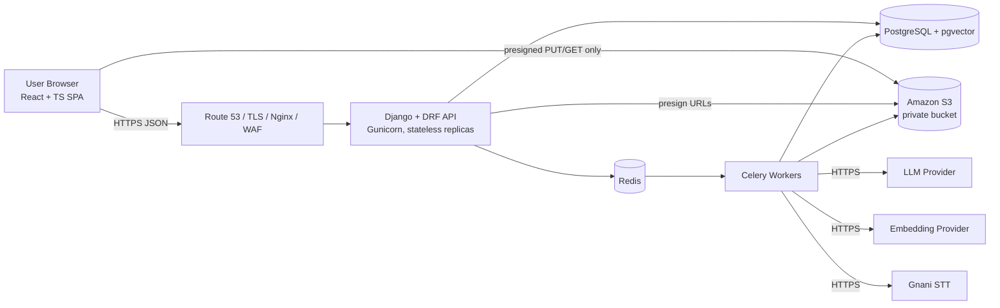
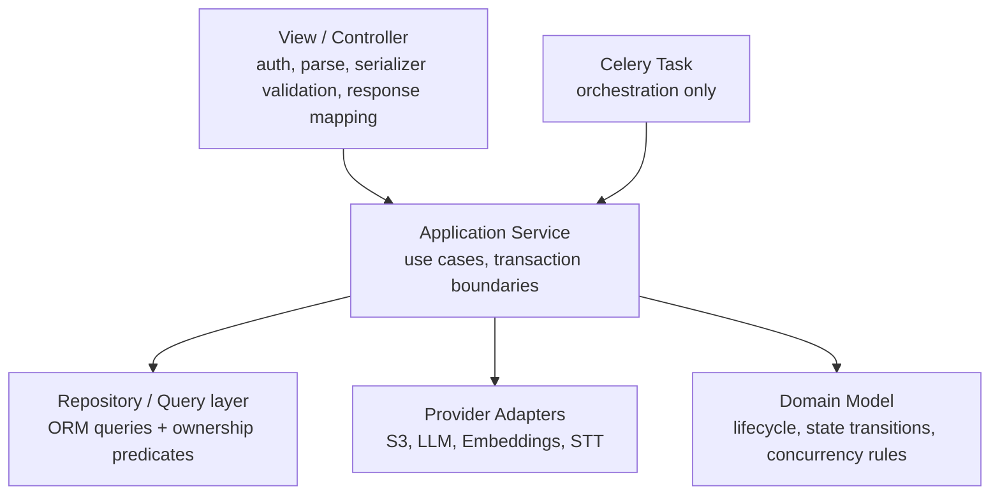
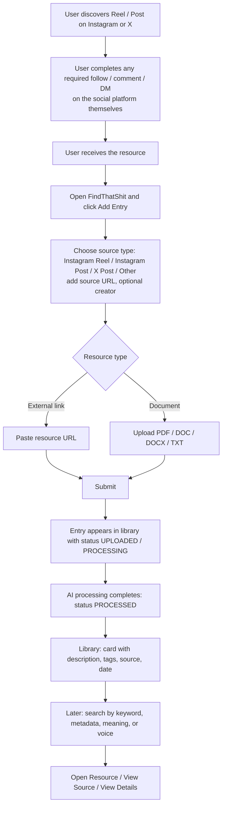
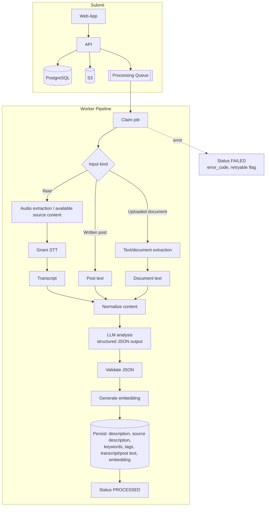
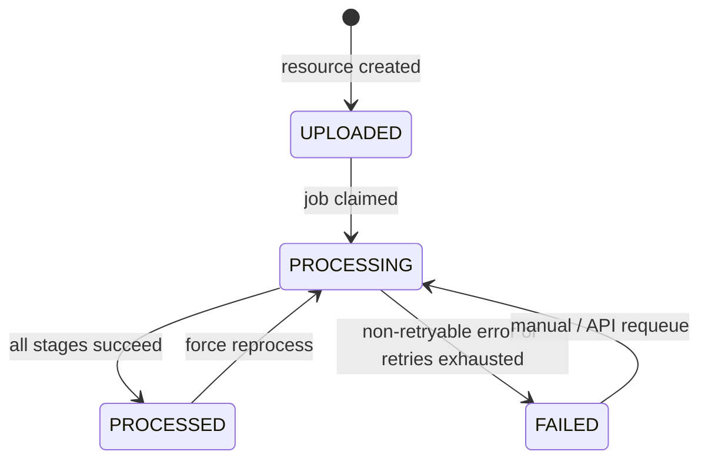
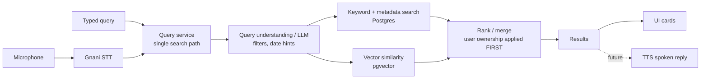
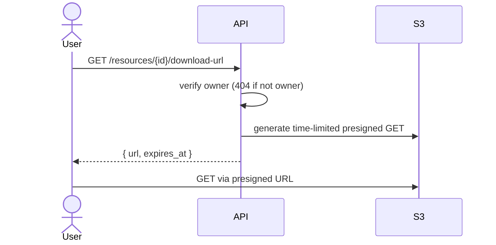

# FindThatShit

> AI-powered social resource library: **Save a resource → Understand it → Organize it → Find it later.**

This README is the **primary context file for AI coding agents** (and humans) working on this repository. It records every design decision made so far, from the Product Brief & SOW and the MVP Senior Technical Documentation. It is a living document: when a decision changes, update this file in the same change (see [Section 18](#18-maintaining-this-file)).

---

## 0. How to Use This File (Agents Read First)

1. Read this file fully before writing code.
2. Read `AGENTS.md` (coding rules) and `implementation.md` (what is already built).
3. The **repository code is the source of truth for current behavior**. This README is the source of truth for **intent and decisions**. If they conflict, flag the conflict; do not silently pick one.
4. Do not invent behavior. If something is not specified here, mark it as a gap and ask or choose the simplest option consistent with this document.
5. Respect scope: implement only what is requested. Anything in [Out of Scope](#32-out-of-scope-for-mvp) or [Future Scope](#33-future-scope) must not be built unless explicitly requested.

### Status legend used in this file

| Tag | Meaning |
|---|---|
| **[DECIDED]** | Stated in the SOW or technical documentation. Treat as binding. |
| **[PROPOSED]** | Added by this README to fill a gap or resolve ambiguity. Binding until changed, but easier to revise. |
| **[OPEN]** | Not yet decided. Decide at implementation time, then record the choice here and in `implementation.md`. |
| **[FUTURE]** | Not in MVP. Design must not block it, but do not build it. |

---

## 1. Product Summary

**FindThatShit** helps users save, organize, understand, and retrieve valuable resources (templates, PDFs, tools, Notion pages, Drive folders, websites) discovered through Instagram, X (Twitter), and other platforms.

**Problem:** users find useful resources on social media, then cannot remember where they found them or how to locate them.

**Solution:** store the resource together with its source and AI-generated context so it is searchable later.

**Product principle:** not just a bookmarking tool; a **personal memory layer** for valuable resources discovered online.

**Primary success criterion:** can a user *retrieve* a resource later from what they *remember* about it (e.g. "that resume template I saw on Instagram a few weeks ago") without knowing the exact filename, creator handle, or URL. Saves-count is **not** the success metric.

**Long-term vision:** Discover → Save → Understand → Organize → Remember → Retrieve.

**Target load:** 100 concurrent users, 500 daily active users minimum. [DECIDED]

---

## 2. Key Design Decisions (Summary)

| # | Decision | Status |
|---|---|---|
| D1 | **Modular monolith** + asynchronous workers. No microservices in MVP. | DECIDED |
| D2 | Backend: Python 3.12+, Django, Django REST Framework. | DECIDED |
| D3 | Frontend: React + TypeScript + Vite + Tailwind CSS (Node 20+). | DECIDED |
| D4 | Database: PostgreSQL 15+ with **pgvector** (no separate vector DB). | DECIDED |
| D5 | Object storage: Amazon S3, private bucket, presigned URLs only. DB stores keys, never binaries. | DECIDED |
| D6 | Queue: Redis 7+ and Celery. Jobs are idempotent and retryable. Payloads carry IDs only. | DECIDED |
| D7 | AI behind small adapter interfaces: LLM, embeddings, Gnani STT. No provider calls from HTTP views. | DECIDED |
| D8 | No Go service in MVP; may be introduced later behind a stable boundary if measured load justifies it. | DECIDED |
| D9 | Users complete social actions (follow/comment/like/DM) themselves. The app never automates social platforms. | DECIDED |
| D10 | Concurrency: optimistic locking (`version`), idempotency keys, DB unique constraints, `SELECT ... FOR UPDATE SKIP LOCKED` for job claiming. No distributed locks for CRUD. | DECIDED |
| D11 | Hybrid search design: keyword/metadata now, embeddings stored from day one, semantic/hybrid ranking enabled when populated. | DECIDED |
| D12 | Voice is architecture-ready only: voice transcription feeds the **same** query service as text search. | DECIDED |
| D13 | Deployment: Docker + AWS; Nginx reverse proxy; Gunicorn for Django; Route 53 for DNS. | DECIDED |
| D14 | All enum values are `UPPER_SNAKE_CASE` in DB and API. | PROPOSED |
| D15 | Auth transport: Django session cookie with DRF `SessionAuthentication`; unsafe browser requests use the CSRF cookie value in `X-CSRFToken`. | DECIDED |
| D16 | Embedding vector dimension depends on chosen embedding model; set via `EMBEDDING_DIMENSIONS` config and fixed in the migration. | OPEN |
| D17 | Phase 2 uploads use one private S3 file per resource, with MIME-derived keys and presigned PUT/GET URLs. | DECIDED |
| D18 | Search route is `GET /api/v1/resources/search` (Phase 4). Resource routes use `<uuid:pk>`, so `search` is never read as an id. | DECIDED |
| D19 | Processing routes are `POST /api/v1/resources/{id}/process` and `GET /api/v1/resources/{id}/processing` (Phase 3). | DECIDED |
| D20 | Idempotency keys (`Idempotency-Key` header, `idempotency_keys` table) are built in Phase 3 together with `ProcessingJob`. | DECIDED |

---

## 3. Scope

### 3.1 MVP scope [DECIDED]

- **Authentication:** registration, login, logout, basic profile.
- **Dashboard:** resource list/grid, sorting, filtering, search.
- **Add Entry:** source type, source URL, creator (optional), resource URL, file upload, optional title/tags.
- **Storage:** external resource URLs (stored as references) and S3-backed uploaded files.
- **AI processing:** source content processing, Reel transcription where available, document/post text extraction, descriptions, summaries, tags, keywords.
- **Resource detail:** full source / resource / AI metadata view.
- **Search:** keyword, creator, tag, description, and source-content search.
- **Semantic retrieval foundation:** embeddings stored for descriptions, transcripts, and tags.
- **Voice UI foundation:** microphone interaction and backend prepared for Gnani STT, retrieval, TTS.

### 3.2 Out of scope for MVP [DECIDED]

Do **not** build any of these:

- Automatic Instagram/X login or account control.
- Automatic follow, like, comment, or DM.
- Automatic Instagram inbox reading.
- Temporary/proxy social accounts.
- Automatic comment deletion.
- Fully automated social-media resource claiming.
- Unofficial browser automation against social platforms.
- Complex platform-specific integrations before the core workflow is validated.
- Cross-user shared resource records.
- A dedicated search/vector database.

### 3.3 Future scope [FUTURE]

Direct share-to-FindThatShit, automatic source understanding (creator, resource name, claim keyword), guided claim assistant, native mobile app with Share Sheet, conversational voice/text assistant over the whole library, official platform API integrations, resource intelligence (dedup, related-resource recommendations, auto-categorization, improved ranking).

All future ingestion paths must **normalize into the same** `Resource / SourceContent / File / ProcessingJob` model.

### 3.4 MVP acceptance criteria [DECIDED]

1. User can create an account and access a private resource library.
2. User can add an Instagram Reel/Post or X/Twitter Post as a source.
3. User can optionally provide creator information.
4. User can attach an external resource URL.
5. User can upload a supported document.
6. Uploaded documents are stored in S3 and retrieved securely.
7. System processes supported source/document content asynchronously.
8. System generates and stores AI descriptions and metadata.
9. Reel audio is transcribed when source/audio access is available.
10. User can search saved resources by metadata and content.
11. User can open the original source and the saved resource.
12. Architecture supports future semantic and voice retrieval without major redesign.

### 3.5 Phase plan and status

| Phase | Scope | Status |
|---|---|---|
| 1 | Foundation + accounts: Django/DRF, PostgreSQL, Redis, Celery, health, session auth, error envelope | Done |
| 2 | Resource core + storage: models, CRUD, tags, pagination, S3 presigned upload/download | Code done; live S3 check and full test suite pending sign-off |
| 3 | Async processing + AI: `ProcessingJob`, extractors (PDF/DOCX/TXT), AI provider, idempotency, `/process`, `/processing` | Planned |
| 4 | Search + frontend: `GET /resources/search`, React screens | Planned |
| 5 | Integration, hardening, security/processing/upload/search test passes | Planned |

---

## 4. Architecture

### 4.1 Technology stack

| Layer | Technology | Notes |
|---|---|---|
| Frontend | React, TypeScript, Vite, Tailwind CSS | SPA over HTTPS |
| API | Django + DRF | Auth, CRUD, authorization, search orchestration, signed URLs |
| Database | PostgreSQL + pgvector | System of record + vectors |
| Queue / workers | Redis + Celery | Extraction, STT, LLM, embeddings, retries |
| Object storage | Amazon S3 | Private; presigned upload/download |
| AI | LLM + embeddings | Summaries, tags, keywords, query understanding, semantic retrieval |
| Speech | Gnani STT; TTS for future voice replies | Reel transcription and voice queries |
| Infra | Docker, AWS, Nginx, Gunicorn, Route 53 | Small number of independently manageable processes |

### 4.2 High-level architecture (HLD)



### 4.3 Component responsibilities and scaling boundaries [DECIDED]

| Component | Responsibility | Scaling |
|---|---|---|
| React Web | UI, form validation, search, upload initiation, status display | CDN / static hosting |
| Django API | Auth, CRUD, authorization, search orchestration, signed URL creation | Horizontal replicas |
| PostgreSQL | Transactional state, search metadata, vectors | Vertical first; read replicas later |
| S3 | Binary resource storage | Managed |
| Redis | Queue / coordination | Managed |
| Celery workers | Extraction, STT, LLM, embeddings, retries | Horizontal, independent of API |
| AI / STT providers | External inference | Provider limits, retries |

### 4.4 Security boundaries [DECIDED]

- Internet → TLS → Nginx/WAF/load balancer → API.
- API → private PostgreSQL / Redis / S3 only.
- Browser → S3 only via scoped, short-lived presigned URLs.
- Workers → external AI providers over outbound HTTPS using secret-managed credentials.
- Every resource operation is constrained by authenticated user ownership.

### 4.5 API layering (LLD) [DECIDED]



Rules:
- No AI provider calls from HTTP views.
- Celery tasks orchestrate only; domain logic lives in services so it is testable without Celery.
- Do not build a multi-provider abstraction until a second provider is actually required.

---

## 5. User Flow

### 5.1 End-to-end user journey



### 5.2 Add Entry form fields [DECIDED]

| UI field | Required | Notes |
|---|---|---|
| Source type | Yes | `INSTAGRAM_REEL`, `INSTAGRAM_POST`, `X_POST`, `OTHER` |
| Source URL | Yes | Link to original Reel/Post |
| Creator name | No | May be extracted where technically possible |
| Resource URL | One of URL or upload | Google Drive/Docs, Notion, website, GitHub, Dropbox, other |
| Upload resource | One of URL or upload | PDF, DOC/DOCX, TXT, other supported formats |
| Title / tags | No | User-entered; AI fills gaps |

### 5.3 Screens [DECIDED]

- **Dashboard / Library:** list/grid of compact cards. Each card: title, AI description, creator, source platform, source link, resource link or file access, tags, date added, processing status, actions (Open Resource, View Source, View Details). Supports sorting, filtering, search.
- **Add Entry:** modal or page with fields above.
- **Resource Detail:** Source (platform, creator, URL, source type); Source content (Reel transcript or post text); Resource (title, description, resource type, URL/file); AI metadata (tags, keywords, summaries); System metadata (date added, processing status, last processed timestamp).
- **Search:** keyword/metadata in MVP; semantic once embeddings are populated; voice UI feeds the same query path.

### 5.4 Entry creation sequence

```mermaid
sequenceDiagram
    actor User
    participant Web as React SPA
    participant API as Django API
    participant DB as PostgreSQL
    participant S3
    participant Q as Redis/Celery
    participant W as Worker

    User->>Web: Fill Add Entry form
    Web->>API: POST /api/v1/resources (Idempotency-Key)
    API->>DB: BEGIN; insert resource (UPLOADED), source_content; COMMIT
    API-->>Web: 201 resource + processing_status

    alt Document upload
        Web->>API: POST /resources/{id}/upload-url
        API->>DB: insert files row (s3_object_key)
        API-->>Web: presigned PUT URL + object key
        Web->>S3: PUT file bytes (direct)
        Web->>API: POST /resources/{id}/process
    else External URL only
        Web->>API: POST /resources/{id}/process
    end

    API->>DB: insert processing_job (PENDING)
    API->>Q: enqueue process_resource(resource_id) AFTER commit
    API-->>Web: 202 job/status

    Q->>W: deliver task
    W->>DB: claim job (FOR UPDATE SKIP LOCKED) -> RUNNING
    W->>S3: read file (if any)
    W->>W: extract text / STT (outside DB transaction)
    W->>W: LLM analysis -> JSON, validate
    W->>W: embeddings
    W->>DB: persist content, metadata, tags, embedding; status PROCESSED
    Web->>API: GET /resources/{id}/processing (poll)
    API-->>Web: PROCESSED
```

> Note [PROPOSED]: the SOW lists creation, upload, and processing as one flow. Splitting into `create → upload-url → PUT → process` follows the documented endpoint list. When no file is involved, the client calls `process` (or the API may auto-enqueue on create; choose one and record it in `implementation.md`).

---

## 6. Data Flow

### 6.1 Processing data flow



### 6.2 What the LLM produces [DECIDED]

- **Resource description:** what the resource is, contains, and is useful for.
- **Source description:** what the Reel/Post is about and how it relates to the resource.
- **Transcript/content:** Reel transcript or extracted post text (stored in `source_contents`).
- **Tags/topics:** e.g. Resume, Python, Notion, Interview Prep, DevOps, Templates.
- **Keywords.**

LLM output contract [PROPOSED]:

```json
{
  "title": "string (max 255)",
  "resource_type": "PDF | DOCUMENT | SPREADSHEET | NOTION | GOOGLE_DRIVE | GITHUB | WEBSITE | OTHER",
  "resource_description": "string",
  "source_description": "string",
  "keywords": ["string"],
  "tags": ["string"]
}
```

Always validate returned JSON against this schema before persisting. Generated metadata is **not** authoritative fact.

### 6.3 Processing state machine [DECIDED]

Resource-level status:



Job-level (`processing_jobs`): `status` in `PENDING`, `RUNNING`, `SUCCEEDED`, `FAILED` [PROPOSED values]; `stage` in `EXTRACT_SOURCE`, `TRANSCRIBE`, `EXTRACT_DOCUMENT`, `ANALYZE`, `EMBED` [PROPOSED values].

Failure rules:
- STT failure or missing Reel audio **must not invalidate** an otherwise valid resource; the entry stays usable.
- Retry only explicitly retryable errors, with exponential backoff and bounded attempts; then mark `FAILED`.
- Never duplicate the resource on retry.
- External calls happen **outside** DB transactions.

### 6.4 Search and voice data flow



Example voice query: "Find the Python cheat sheet I saved from Instagram last month." Voice **never** gets a second search implementation; it only produces text for the same query service. [DECIDED]

### 6.5 File access flow



---

## 7. Object Relationships

### 7.1 Entity-relationship diagram

```mermaid
erDiagram
    USERS ||--o{ RESOURCES : owns
    USERS ||--o{ TAGS : owns
    USERS ||--o{ AUDIT_EVENTS : triggers
    USERS ||--o{ IDEMPOTENCY_KEYS : sends
    RESOURCES ||--o| SOURCE_CONTENTS : "has one"
    RESOURCES ||--o{ FILES : has
    RESOURCES ||--o{ RESOURCE_TAGS : tagged
    TAGS ||--o{ RESOURCE_TAGS : applied
    RESOURCES ||--o{ EMBEDDINGS : has
    RESOURCES ||--o{ PROCESSING_JOBS : has
    RESOURCES ||--o{ AUDIT_EVENTS : "referenced by"

    USERS {
        uuid id PK
        string email UK
        string name
        string password_hash
        datetime created_at
        datetime updated_at
    }
    RESOURCES {
        uuid id PK
        uuid user_id FK
        string title
        string creator
        string platform
        string source_url
        string resource_url
        string resource_type
        text description
        string processing_status
        int version
        datetime last_processed_at
        datetime created_at
        datetime updated_at
    }
    SOURCE_CONTENTS {
        uuid id PK
        uuid resource_id FK_UK
        string source_type
        text transcript
        text post_text
        text source_description
        json extracted_metadata
    }
    FILES {
        uuid id PK
        uuid resource_id FK
        string s3_object_key UK
        string filename
        string mime_type
        bigint file_size
        string checksum
        datetime created_at
    }
    TAGS {
        uuid id PK
        uuid user_id FK
        string name
        string normalized_name
        datetime created_at
    }
    RESOURCE_TAGS {
        bigint id PK
        uuid resource_id FK
        uuid tag_id FK
        datetime created_at
    }
    EMBEDDINGS {
        uuid id PK
        uuid resource_id FK
        vector vector
        string model
        string content_hash
        datetime created_at
    }
    PROCESSING_JOBS {
        uuid id PK
        uuid resource_id FK
        string stage
        string status
        int attempt
        string idempotency_key UK
        string error_code
        text error_message
        boolean is_retryable
        datetime started_at
        datetime completed_at
    }
    AUDIT_EVENTS {
        uuid id PK
        uuid user_id FK
        uuid resource_id FK_nullable
        string action
        string request_id
        json metadata
        datetime created_at
    }
    IDEMPOTENCY_KEYS {
        uuid id PK
        uuid user_id FK
        string key
        string endpoint
        uuid resource_id
        int response_status
        datetime created_at
    }
```

### 7.2 Relationship rules [DECIDED]

- One user owns many resources. **Ownership is never inferred from client input**; it always comes from the authenticated user.
- One resource has **one** logical `source_content` and **zero or more** files, tags (via `resource_tags`), embeddings, and processing jobs.
- Deleting a resource may cascade only to resource-owned metadata, jobs, files, and embeddings. User deletion is a controlled account-lifecycle operation, not a casual cascade.
- No cross-user shared resource records in MVP.

---

## 8. Database Schema

Conventions: UUID primary keys, UTC timestamps, explicit max lengths, `NOT NULL` where the domain requires a value, CHECK constraints for enum-like columns, uniqueness enforced in the DB (not only in app code). Add indexes only with a query justification.

### 8.1 `users` [DECIDED]

| Field | Type | Constraints |
|---|---|---|
| `id` | UUID | PK |
| `email` | varchar(254) | UNIQUE, NOT NULL (store normalized lowercase) |
| `name` | varchar(150) | NOT NULL |
| `password_hash` | varchar(128+) | Django auth field; never returned by API |
| `created_at` | timestamptz | NOT NULL |
| `updated_at` | timestamptz | NOT NULL |

### 8.2 `resources` [DECIDED, fields marked * PROPOSED]

| Field | Type | Constraints / notes |
|---|---|---|
| `id` | UUID | PK |
| `user_id` | UUID | FK users, NOT NULL |
| `title` | varchar(255) | User-entered or AI-generated; may be empty until processed |
| `creator` | varchar(255) | Empty string when not provided |
| `platform` | varchar(20) | `INSTAGRAM`, `X`, `OTHER`; derived from `source_content.source_type` * |
| `source_url` | varchar(2048) | NOT NULL; validated URL |
| `resource_url` | varchar(2048) | Empty when a file is uploaded |
| `resource_type` | varchar(30) | See enum below |
| `description` | text | AI-generated resource description |
| `keywords` * | jsonb | AI-generated keyword list |
| `processing_status` | varchar(20) | `UPLOADED`, `PROCESSING`, `PROCESSED`, `FAILED`; default `UPLOADED` |
| `version` | integer | NOT NULL, default 1; optimistic locking |
| `last_processed_at` * | timestamptz | Nullable; shown in detail view |
| `created_at` | timestamptz | NOT NULL; serialized in API as `date_added` * |
| `updated_at` | timestamptz | NOT NULL |

Indexes: `(user_id, created_at)` [DECIDED]; `(user_id, processing_status)` and the keyword-search index are added when the query that needs them is implemented.
Check: at least one of `resource_url` or an attached `files` row must exist before processing (enforce in service layer).

### 8.3 `source_contents` [DECIDED, `source_description` * PROPOSED]

| Field | Type | Constraints / notes |
|---|---|---|
| `id` | UUID | PK |
| `resource_id` | UUID | FK resources, UNIQUE (one per resource), ON DELETE CASCADE |
| `source_type` | varchar(20) | `INSTAGRAM_REEL`, `INSTAGRAM_POST`, `X_POST`, `OTHER` |
| `transcript` | text | Reel audio transcript; empty until available |
| `post_text` | text | Extracted written post content; empty until available |
| `source_description` * | text | AI description of the Reel/Post and how it relates to the resource |
| `extracted_metadata` | jsonb | Anything extracted from source (e.g. creator handle) |
| `created_at`, `updated_at` | timestamptz | NOT NULL |

### 8.4 `files` [DECIDED]

| Field | Type | Constraints / notes |
|---|---|---|
| `id` | UUID | PK |
| `resource_id` | UUID | FK resources, ON DELETE CASCADE |
| `s3_object_key` | varchar(1024) | UNIQUE; format in [Section 11](#11-storage-s3) |
| `filename` | varchar(255) | Original filename (sanitized) |
| `mime_type` | varchar(127) | Validated against allow-list |
| `file_size` | bigint | Bytes; validated against max |
| `checksum` | varchar(64) | Empty until verified |
| `created_at` | timestamptz | NOT NULL |

### 8.5 `tags` and `resource_tags` [DECIDED]

`tags`:

| Field | Type | Constraints |
|---|---|---|
| `id` | UUID | PK |
| `user_id` | UUID | FK users, NOT NULL; tags are private per user |
| `name` | varchar(50) | Display form |
| `normalized_name` | varchar(50) | Lowercased, trimmed |
| `created_at` | timestamptz | NOT NULL |

Constraint: UNIQUE `(user_id, normalized_name)`.

> Only relevant if global tags are ever added (not planned): PostgreSQL UNIQUE treats NULLs as distinct, so tags with `user_id IS NULL` would need a partial unique index on `normalized_name`.

`resource_tags`:

| Field | Type | Constraints |
|---|---|---|
| `id` | bigint | PK (auto) |
| `resource_id` | UUID | FK resources, ON DELETE CASCADE |
| `tag_id` | UUID | FK tags, ON DELETE CASCADE |
| `created_at` | timestamptz | NOT NULL |

Constraint: UNIQUE `(resource_id, tag_id)` named `resource_tags_resource_id_tag_id_uq`.

### 8.6 `embeddings` [DECIDED]

| Field | Type | Constraints / notes |
|---|---|---|
| `id` | UUID | PK |
| `resource_id` | UUID | FK resources, ON DELETE CASCADE |
| `vector` | vector(N) | N = `EMBEDDING_DIMENSIONS` [OPEN]; vector index added as scale requires |
| `model` | varchar(100) | Embedding model name/version |
| `content_hash` | varchar(64) | Hash of the normalized text embedded; skip re-embedding if unchanged |
| `created_at` | timestamptz | NOT NULL |

Embed input = normalized text of description + transcript/post text + tags. Generate only after normalized content exists.

### 8.7 `processing_jobs` [DECIDED]

| Field | Type | Constraints / notes |
|---|---|---|
| `id` | UUID | PK |
| `resource_id` | UUID | FK resources, ON DELETE CASCADE |
| `stage` | varchar(30) | Current pipeline stage |
| `status` | varchar(20) | `PENDING`, `RUNNING`, `SUCCEEDED`, `FAILED` |
| `attempt` | integer | default 0 |
| `idempotency_key` | varchar(128) | UNIQUE |
| `error_code` | varchar(64) | Nullable; provider error class |
| `error_message` | text | Nullable; never exposed raw to end users |
| `is_retryable` * | boolean | Whether failure may be retried |
| `started_at`, `completed_at` | timestamptz | Nullable |
| `created_at`, `updated_at` | timestamptz | NOT NULL |

Index: `(status, created_at)`. Claim jobs with `SELECT ... FOR UPDATE SKIP LOCKED`.

### 8.8 `audit_events` [DECIDED]

| Field | Type | Constraints / notes |
|---|---|---|
| `id` | UUID | PK |
| `user_id` | UUID | FK users |
| `resource_id` | UUID | FK resources, nullable |
| `action` | varchar(50) | e.g. `RESOURCE_CREATED`, `RESOURCE_DELETED`, `FILE_DOWNLOAD_URL_ISSUED` |
| `request_id` | varchar(64) | Trace id |
| `metadata` | jsonb | No secrets or raw sensitive data |
| `created_at` | timestamptz | NOT NULL |

Index: `(user_id, created_at)`.

### 8.9 `idempotency_keys` [PROPOSED]

The documentation requires the server to persist idempotency keys and the resulting object reference but does not name a table. This README proposes one:

| Field | Type | Constraints |
|---|---|---|
| `id` | UUID | PK |
| `user_id` | UUID | FK users |
| `key` | varchar(128) | NOT NULL |
| `endpoint` | varchar(100) | e.g. `POST /resources` |
| `resource_id` | UUID | Nullable; resulting object |
| `response_status` | integer | Replayed on duplicate |
| `created_at` | timestamptz | NOT NULL |

Constraint: UNIQUE `(user_id, key, endpoint)`. A duplicate request returns the original result; a same key with a different payload returns 409.

### 8.10 Enum reference [PROPOSED values, UPPER_SNAKE]

| Enum | Values |
|---|---|
| `source_type` | `INSTAGRAM_REEL`, `INSTAGRAM_POST`, `X_POST`, `OTHER` |
| `platform` | `INSTAGRAM`, `X`, `OTHER` |
| `resource_type` | `PDF`, `DOCUMENT`, `SPREADSHEET`, `NOTION`, `GOOGLE_DRIVE`, `GITHUB`, `DROPBOX`, `WEBSITE`, `OTHER` |
| `processing_status` | `UPLOADED`, `PROCESSING`, `PROCESSED`, `FAILED` |
| `job_status` | `PENDING`, `RUNNING`, `SUCCEEDED`, `FAILED` |
| `job_stage` | `EXTRACT_SOURCE`, `TRANSCRIBE`, `EXTRACT_DOCUMENT`, `ANALYZE`, `EMBED` |
| `search_mode` | `KEYWORD`, `SEMANTIC`, `HYBRID` |

---

## 9. Concurrency and Data Integrity [DECIDED]

| Concern | Mechanism |
|---|---|
| Lost updates on resources | Optimistic locking: `UPDATE ... WHERE id = :id AND version = :expected`, increment `version`; zero rows updated returns **409** |
| Multi-row consistency | `transaction.atomic()` for create, tag changes, job state transitions |
| Two workers claiming one job | Short transaction with `SELECT ... FOR UPDATE SKIP LOCKED`, mark `RUNNING`, commit, then do external work outside the transaction |
| Duplicate submissions | `Idempotency-Key` header persisted; unique constraints |
| Duplicates | UNIQUE on tags `(user_id, normalized_name)`, `resource_tags` `(resource_id, tag_id)`, `files.s3_object_key`, `processing_jobs.idempotency_key` |
| Stale queue payloads | Payloads contain **IDs only**; worker reloads latest committed state |
| Enqueue timing | Enqueue **after** commit (`transaction.on_commit`) |
| Caching | Never use a shared mutable in-memory cache as source of truth |
| Distributed locks | Not used for normal CRUD |

Delete flow: authorize owner → transactionally delete (or mark) resource metadata → remove S3 object **asynchronously after commit**.

---

## 10. API Design

### 10.1 Conventions [DECIDED unless tagged]

- Base path: `/api/v1`. Versioned in the URL.
- Transport: HTTPS only. Format: JSON. Field names: `snake_case`.
- Path segments: lowercase, plural nouns for collections; multiword actions use kebab-case (`upload-url`, `download-url`).
- Every private endpoint requires authentication; every resource operation is scoped by `request.user`.
- Request tracing: every response carries `X-Request-ID`. From Phase 3, clients may send `Idempotency-Key` on `POST /resources` and `POST /resources/{id}/process`.
- File bytes **never** pass through the API; they go directly to S3 via presigned URLs.
- Pagination on all list/search endpoints: query `page` (default 1) and `limit` (default 20, max 50; stated range 20 to 50). [PROPOSED exact numbers]
- Resource representation always includes `id`, `processing_status`, timestamps, and `version`.

Status codes:

| Code | Use |
|---|---|
| 200 | OK (read/update) |
| 201 | Created |
| 202 | Accepted (queued work) |
| 204 | Deleted, no body [PROPOSED] |
| 400 | Validation error |
| 401 | Missing/invalid authentication |
| 403 | Authenticated but forbidden |
| 404 | Not found **or** not owned (when existence must not be disclosed; default for other users' resources) |
| 409 | Version conflict or idempotency conflict |
| 429 | Rate limited |
| 5xx | Server/provider failure (no internals leaked) |

### 10.2 Error envelope [PROPOSED]

```json
{
  "error": {
    "code": "VERSION_CONFLICT",
    "message": "Resource was modified. Refresh and retry.",
    "details": { "field_errors": { "title": ["This field is too long."] } },
    "request_id": "9f1c2b..."
  }
}
```

Error `code` values are `UPPER_SNAKE_CASE` (e.g. `VALIDATION_ERROR`, `UNAUTHENTICATED`, `FORBIDDEN`, `NOT_FOUND`, `VERSION_CONFLICT`, `IDEMPOTENCY_CONFLICT`, `RATE_LIMITED`, `UNSUPPORTED_FILE_TYPE`, `FILE_TOO_LARGE`, `FILE_NOT_FOUND`, `FILE_NOT_UPLOADED`, `STORAGE_ERROR`, `INTERNAL_ERROR`, `INVALID_CREDENTIALS`, `METHOD_NOT_ALLOWED`, `UNSUPPORTED_MEDIA_TYPE`).

| Phase 2 error | HTTP | Meaning |
|---|---|---|
| `VERSION_CONFLICT` | 409 | stale `version` on PATCH |
| `UNSUPPORTED_FILE_TYPE` | 400 | MIME type is not PDF, DOCX or TXT |
| `FILE_TOO_LARGE` | 400 | `size` is above `MAX_UPLOAD_SIZE_BYTES` |
| `FILE_NOT_FOUND` | 404 | resource has no file row |
| `FILE_NOT_UPLOADED` | 409 | file row exists but the object is not in S3 yet |
| `STORAGE_ERROR` | 502 | S3 unreachable, bad credentials or bucket; details are logged, never returned |

### 10.3 Endpoint list [DECIDED]

| Method | Endpoint | Purpose | Auth | Success |
|---|---|---|---|---|
| POST | `/api/v1/auth/register` | Create account | Public | 201 |
| POST | `/api/v1/auth/login` | Create session/token | Public | 200 |
| POST | `/api/v1/auth/logout` | Revoke session | User | 204 |
| GET | `/api/v1/auth/me` | Current user | User | 200 |
| POST | `/api/v1/resources/{id}/upload-url` | Create S3 upload URL | Owner | 200 |
| GET | `/api/v1/resources/{id}/download-url` | Create S3 download URL | Owner | 200 |
| GET | `/api/v1/resources` | List/filter resources | User | 200 |
| POST | `/api/v1/resources` | Create resource entry | User | 201 |
| GET | `/api/v1/resources/{id}` | Resource detail | Owner | 200 |
| PATCH | `/api/v1/resources/{id}` | Update metadata (requires `version`) | Owner | 200 |
| DELETE | `/api/v1/resources/{id}` | Delete resource | Owner | 204 |

**Planned [DECIDED route names]**

| Method | Endpoint | Purpose | Auth | Success | Phase |
|---|---|---|---|---|---|
| POST | `/api/v1/resources/{id}/process` | Queue/requeue processing (`Idempotency-Key`) | Owner | 202 | 3 |
| GET | `/api/v1/resources/{id}/processing` | Processing status | Owner | 200 | 3 |
| GET | `/api/v1/resources/search` | Keyword search (semantic/hybrid later) | User | 200 | 4 |

Standalone tag endpoints (`/tags`) are not planned for the MVP: tags are sent as a list on create and PATCH.

Future (not MVP) [FUTURE]: a voice endpoint must reuse the query service behind `/resources/search`; do not add a parallel search implementation.

### 10.4 Request and response shapes

Shapes below are [PROPOSED] refinements of the documented contracts. Keep them consistent across endpoints.

**POST `/api/v1/auth/register`**
```json
// request
{ "email": "a@b.com", "name": "Ada", "password": "..." }
// 201
{ "id": "uuid", "email": "a@b.com", "name": "Ada", "created_at": "2026-11-07T10:00:00Z" }
```

**POST `/api/v1/resources`** (the `Idempotency-Key` header is added in Phase 3)
```json
// request
{
  "source_type": "INSTAGRAM_REEL",
  "source_url": "https://www.instagram.com/reel/abc/",
  "creator": "optional_handle",
  "resource_url": "https://notion.so/...",   // omit when uploading a file
  "title": "optional",
  "tags": ["resume", "templates"]            // optional
}
// 201
{
  "id": "uuid",
  "title": "",
  "creator": "optional_handle",
  "platform": "INSTAGRAM",
  "source_type": "INSTAGRAM_REEL",
  "source_url": "...",
  "resource_url": "...",
  "resource_type": "NOTION",
  "description": "",
  "tags": ["resume", "templates"],
  "processing_status": "UPLOADED",
  "version": 1,
  "date_added": "2026-11-07T10:00:00Z",
  "updated_at": "2026-11-07T10:00:00Z"
}
```

**GET `/api/v1/resources`** query: `platform`, `source_type`, `resource_type`, `tag`, `processing_status`, `creator`, `sort` (`date_added`, `-date_added`, `title`, `-title`), `page`, `limit`. Invalid `page`/`limit` return 400; a page past the end returns 404. Free-text `q` and date filters belong to `/resources/search` (Phase 4).
```json
{
  "count": 134,
  "page": 1,
  "limit": 20,
  "results": [ { "...resource summary (card fields)..." } ]
}
```

**GET `/api/v1/resources/{id}`** returns the full detail:
```json
{
  "id": "uuid",
  "source": {
    "platform": "INSTAGRAM", "source_type": "INSTAGRAM_REEL",
    "creator": "handle", "source_url": "...",
    "transcript": "...", "post_text": null, "source_description": "..."
  },
  "resource": {
    "title": "...", "description": "...", "resource_type": "PDF",
    "resource_url": null,
    "file": { "filename": "Modern_Resume_Final.pdf", "mime_type": "application/pdf", "file_size": 120394 }
  },
  "ai_metadata": { "tags": ["resume"], "keywords": ["software engineering"] },
  "system": {
    "date_added": "...", "processing_status": "PROCESSED",
    "last_processed_at": "...", "version": 3
  }
}
```

**PATCH `/api/v1/resources/{id}`**
```json
// request (version required)
{ "title": "New title", "creator": "handle", "tags": ["python"], "version": 3 }
// 200: updated resource with version 4
// 409: VERSION_CONFLICT when version is stale
```

**POST `/api/v1/resources/{id}/upload-url`**
```json
// request
{ "filename": "Modern_Resume_Final.pdf", "mime_type": "application/pdf", "size": 120394 }
// 200
{
  "upload_url": "https://s3...presigned",
  "s3_object_key": "findthatshit/users/{user_id}/resources/{resource_id}/resource.pdf",
  "expires_at": "2026-11-07T10:15:00Z",
  "method": "PUT",
  "headers": { "Content-Type": "application/pdf" }
}
```
Validate type allow-list and max size **before** issuing the URL; reject with `UNSUPPORTED_FILE_TYPE` / `FILE_TOO_LARGE`.

**POST `/api/v1/resources/{id}/process`** [Phase 3] (header: `Idempotency-Key`; body `{ "force": false }` optional)
```json
// 202
{ "job_id": "uuid", "resource_id": "uuid", "processing_status": "PROCESSING" }
```

**GET `/api/v1/resources/{id}/processing`** [Phase 3]
```json
{
  "resource_id": "uuid",
  "processing_status": "PROCESSING",
  "stage": "ANALYZE",
  "attempt": 1,
  "error_code": null,
  "last_processed_at": null
}
```

**GET `/api/v1/resources/search`** [Phase 4] query: `q` (required, length-capped), `mode` (`KEYWORD`, `SEMANTIC`, `HYBRID`; default `KEYWORD` until embeddings are populated), filters as in the list endpoint, `page`, `limit`.
```json
{
  "count": 3, "page": 1, "limit": 20,
  "results": [ { "...resource summary...", "score": 0.82, "match_sources": ["DESCRIPTION", "TRANSCRIPT"] } ]
}
```

**GET `/api/v1/resources/{id}/download-url`**
```json
{ "url": "https://s3...presigned-get", "expires_at": "2026-11-07T10:10:00Z" }
```
Returns a recoverable `STORAGE_ERROR` if the S3 object is missing.

Tags are sent as `"tags": ["Python", "Resume"]` on create and PATCH (a PATCH list replaces the existing tags). Names are case-insensitive and de-duplicated.

---

## 11. Storage (S3)

- Bucket is **private**; no public ACLs; browser access only via presigned URLs with short expiry.
- Never expose AWS credentials to the browser. Prefer workload identity/least-privilege IAM.
- Deterministic, user-scoped key format [DECIDED]:

  `findthatshit/users/{user_id}/resources/{resource_id}/resource.{ext}`

- Validate MIME type and size before issuing an upload URL, and again before processing (verify the object exists, e.g. HEAD).
- Allowed formats for MVP: PDF, DOC, DOCX, TXT; others only when explicitly added. [PROPOSED; SOW says "or other supported document formats"]
- External URLs are stored as references only; the app does not fetch or copy arbitrary external content into S3 in MVP.
- CORS on the bucket: explicit allow-list of the web origin; no wildcard.
- The presigned PUT signs `Content-Type` and `Content-Length`: S3 rejects an upload whose type or size differs from what the API approved. The browser must send exactly the `headers` returned by `upload-url`.
- `AWS_REGION` must equal the bucket's region, otherwise presigned URLs fail with redirects or signature errors.
- IAM (least privilege): `s3:PutObject`, `s3:GetObject`, `s3:DeleteObject` on `bucket/<prefix>/*` and `s3:ListBucket` on the bucket. Without `ListBucket`, a missing object returns 403 instead of 404 and surfaces as `STORAGE_ERROR`.
- Use separate buckets (or at minimum prefixes) and separate credentials for dev, staging and production. On AWS use an IAM role, not access keys. Never commit keys.
- Step-by-step setup is in `Docs/PHASE_2_FINISH_GUIDE.md`.

---

## 12. Search Design

- Layer 1 (MVP): keyword and metadata search across title, creator, tags, description, transcript, post text, and resource type. [DECIDED]
- Layer 2: semantic retrieval via pgvector over embeddings of description, transcript, tags. Embeddings are generated and stored from MVP so semantic is enabled without redesign. [DECIDED]
- Hybrid search: combine keyword and vector ranking. Merge strategy (e.g. reciprocal rank fusion) is [OPEN]; choose and record it.
- Keyword implementation: PostgreSQL full-text search is the default direction; the exact index (GIN over a search vector) is [OPEN] and must be justified by the actual query.
- Rules: apply the **user ownership predicate before ranking**; paginate; cap query length; mixed-case/whitespace-normalized tags.
- Acceptance example: query "the resume template I saved for software engineering applications" must be able to retrieve `Modern_Resume_Final.pdf` when stored context matches, without the filename.
- Resources in `PROCESSING` may appear in results with their status; processed fields are absent until committed.

---

## 13. Security Requirements [DECIDED]

- HTTPS-only. DEBUG off outside local. Explicit CORS allow-list; CSRF protection appropriate to the chosen auth transport.
- Authorization is enforced **server-side** at query and object level; hiding UI is not a security boundary.
- Return 404 for other users' resources by default.
- Short-lived access credentials; revocable refresh/session; logout invalidates sessions.
- Rate limiting on auth, create, upload-url, search.
- File upload validation (type, size); treat uploaded documents as untrusted input.
- Secrets in AWS Secrets Manager / Parameter Store or encrypted env config. Never commit secrets, keys, or credentials.
- Never log secrets, tokens, or sensitive user content; never return stack traces or provider errors to users.
- Queue payloads contain **no user data**, only IDs.
- XSS-safe rendering of AI output and source text (render as text, never raw HTML).
- Send only the minimum necessary user content to external AI providers.
- Audit events for important actions.

---

## 14. Naming Conventions

Use these everywhere. Do not introduce a second style for the same thing.

### 14.1 Cross-cutting

| Item | Convention | Example |
|---|---|---|
| Enum values (DB + API) | `UPPER_SNAKE_CASE` | `INSTAGRAM_REEL`, `PROCESSED` |
| JSON fields (API) | `snake_case` | `processing_status`, `source_url` |
| URL path segments | lowercase, plural collections, kebab-case actions | `/resources/{id}/upload-url` |
| Query parameters | `snake_case` | `date_from`, `processing_status` |
| Timestamps | suffix `_at`, UTC ISO-8601 | `created_at`, `last_processed_at` |
| Foreign keys | `<entity>_id` (singular) | `user_id`, `resource_id`, `tag_id` |
| Booleans | prefix `is_` / `has_` | `is_retryable` |
| Counts/sizes | explicit unit/noun | `file_size` (bytes), `attempt` |
| URLs | suffix `_url` | `source_url`, `resource_url`, `upload_url` |
| Error codes | `UPPER_SNAKE_CASE` | `VERSION_CONFLICT` |
| Env vars / settings | `UPPER_SNAKE_CASE` | `AWS_S3_BUCKET_NAME` |
| Git branches | `type/short-description` | `feature/add-entry-modal`, `fix/job-claim-race` |

### 14.2 Python / Django

| Item | Convention | Example |
|---|---|---|
| Modules, packages, functions, variables | `snake_case` | `create_resource`, `resource_id` |
| Classes | `PascalCase`, singular | `Resource`, `ProcessingJob`, `ResourceSerializer` |
| Constants | `UPPER_SNAKE_CASE` | `MAX_UPLOAD_SIZE_BYTES` |
| DB tables | plural `snake_case` (`db_table` explicit) | `resources`, `processing_jobs`, `resource_tags` |
| DB columns | `snake_case`, same as model fields and API fields | `normalized_name` |
| Django apps | short, plural/domain `snake_case` | `accounts`, `resources`, `processing`, `search`, `storage`, `ai` |
| Serializers | `<Model><Purpose>Serializer` | `ResourceCreateSerializer`, `ResourceDetailSerializer` |
| Views | `<Model><Action>View` / `ViewSet` | `ResourceViewSet` |
| Services | `<domain>_service` module, verb functions | `resource_service.create_resource(...)` |
| Query functions | `get_*`, `list_*`, `search_*` | `list_resources_for_user(user, filters)` |
| Provider adapters | `<provider>_client` or `<capability>` module | `storage/s3_client.py`, `ai/llm.py`, `ai/embeddings.py`, `ai/stt.py` |
| Celery tasks | verb phrase, `snake_case` | `process_resource`, `delete_s3_object` |
| Custom exceptions | `PascalCase` + `Error` | `RetryableProviderError`, `VersionConflictError` |
| Tests | `test_<behavior>` in `tests/test_<module>.py` | `test_update_with_stale_version_returns_409` |
| Constraint / index names | `<table>_<columns>_<uq|idx|ck|fk>` | `tags_user_id_normalized_name_uq` |

Avoid vague names: `data`, `obj`, `temp`, `helper`, `process` (unless unambiguous in context).

### 14.3 React / TypeScript

| Item | Convention | Example |
|---|---|---|
| Components | `PascalCase`, file name matches | `ResourceCard.tsx`, `AddEntryModal.tsx` |
| Hooks | `use` + `PascalCase` | `useResources`, `useProcessingStatus` |
| Variables, functions, props | `camelCase` | `processingStatus`, `onSubmit` |
| Types / interfaces | `PascalCase`, no `I` prefix | `Resource`, `ResourceDetail` |
| Enum-like unions | match backend values exactly | `type ProcessingStatus = 'UPLOADED' \| 'PROCESSING' \| 'PROCESSED' \| 'FAILED'` |
| Constants | `UPPER_SNAKE_CASE` | `MAX_PAGE_SIZE` |
| API client | one module (e.g. `api/`), functions `verbNoun` | `listResources`, `createResource` |
| snake_case ↔ camelCase | convert **only** at the API client boundary | the rest of the UI sees camelCase |
| Test files | `*.test.ts(x)` beside the unit | `ResourceCard.test.tsx` |

Avoid `any`; type API boundaries explicitly.

---

## 15. Configuration

Environments: local, test, staging, production. Separate databases and S3 buckets/prefixes for staging vs production. Use UTC everywhere; localize only in the UI.

| Group | Variables (examples) | Rule |
|---|---|---|
| Application | `APP_ENV`, `DEBUG`, `ALLOWED_HOSTS`, `SECRET_KEY` | `DEBUG=false` outside local |
| Database | `DATABASE_URL` | TLS in production |
| Auth | Django session and CSRF cookie settings | Session authentication with CSRF protection |
| S3 | `AWS_S3_BUCKET_NAME`, `AWS_REGION`, `AWS_S3_KEY_PREFIX`, `AWS_S3_ENDPOINT_URL` (optional), `AWS_ACCESS_KEY_ID` / `AWS_SECRET_ACCESS_KEY` (local dev only), `S3_PRESIGN_UPLOAD_TTL_SECONDS`, `S3_PRESIGN_DOWNLOAD_TTL_SECONDS` | Private bucket, signed access only; bucket required when deployed |
| Queue | `REDIS_URL`, `CELERY_WORKER_CONCURRENCY` | IDs only in payloads |
| AI | `LLM_API_KEY`, `LLM_MODEL`, `EMBEDDING_MODEL`, `EMBEDDING_DIMENSIONS` | Secrets never committed |
| STT | `GNANI_STT_ENDPOINT`, `GNANI_STT_API_KEY` | Timeout + retry + error mapping |
| Security | `CORS_ALLOWED_ORIGINS`, `CSRF_TRUSTED_ORIGINS`, `AUTH_THROTTLE_RATE` (10/min), `UPLOAD_THROTTLE_RATE` (30/min) | Explicit allow-list; no wildcard CORS in production |
| Uploads | `MAX_UPLOAD_SIZE_BYTES` (10 MiB default); allowed types are the `ALLOWED_UPLOAD_TYPES` constant in `storage_service.py` | Validated before URL issuance |

All external calls (S3, LLM, embeddings, STT) need bounded timeouts, a retry policy, error classification, and observability.

---

## 16. Deployment and Operations

Baseline sizing [DECIDED]:

| Component | Baseline |
|---|---|
| API | 2 vCPU / 2–4 GB, stateless, horizontal replicas |
| Worker | 2 vCPU / 4 GB, scaled independently |
| PostgreSQL | 2 vCPU / 4–8 GB, managed preferred |
| Redis | 1 vCPU / 1–2 GB, managed preferred |
| S3 | Managed |

Deployment flow: merge to protected `main` → CI (lint, type check, unit, integration, build) → build immutable Docker images (frontend, API, worker) → controlled migration step → deploy API and workers from the **same release version** → smoke test (health endpoints + synthetic resource flow) → monitor error rate, queue depth, worker failures, DB connections, latency. Migrations must be backward-compatible where rollback is possible.

Performance targets: API p95 below 500 ms for ordinary CRUD/search (excluding external AI/file ops), measured rather than a hard SLO. Load-test at 100 concurrent sessions with mixed reads/writes before production release. Use connection pooling; paginate everything.

Known limitations [DECIDED]: social content may be unavailable or incomplete (user supplies source/resource); Reel transcription depends on technically available audio; AI output quality varies and is not authoritative; semantic ranking needs tuning with real retrieval data.

---

## 17. Testing Expectations

Test levels: unit (services, validators, state transitions, adapters), integration (Postgres transactions, S3 presign flow, Redis/Celery, auth/permissions), contract (stable JSON and error shapes), end-to-end (register → add → upload → process → search → retrieve), security, concurrency, performance.

Required behavioral cases (from the documentation):

| ID | Scenario | Expected |
|---|---|---|
| TC-01 | Two users create resources concurrently | Both commit; no cross-user data |
| TC-02 | Two updates use the same version | One succeeds, other gets 409 |
| TC-03 | Same idempotency key sent twice | One resource; second returns original result |
| TC-04 | Two workers claim the same job | Only one processes it |
| TC-05 | User requests another user's resource | 404/403; no data leak |
| TC-06 | Invalid file type / oversize | Rejected before processing |
| TC-07 | STT timeout | Retry or recoverable fail; resource stays usable |
| TC-08 | LLM returns malformed JSON | Validation fails; retry/error recorded |
| TC-09 | Search during processing | Resource may appear with status; processed fields absent |
| TC-10 | S3 object missing | Recoverable storage error on retrieval |

Never report tests as passing unless they were actually run.

### 17.1 Local setup and commands

Repository layout (Windows paths shown; commands are PowerShell):

```text
FindThatShit/
├── README.md  implementation.md  AGENTS.md  docker-compose.yml  .gitignore
├── Docs/                 specs, plans, guides
├── Frontend/             empty until Phase 4
└── backend/
    ├── manage.py  requirements.txt  Dockerfile  .env.example  .env (never committed)
    ├── scripts/smoke_phase2.py
    ├── config/           settings, urls, celery, middleware, exceptions, pagination, health, views
    ├── accounts/         User model, session auth
    └── resources/        models, serializers, views, urls, tasks, services/, providers/, extractors/, tests/
```

Run the automated tests (no PostgreSQL, Redis or AWS needed; they use SQLite and mocks). Always clear the variables afterwards, otherwise `APP_ENV=test` leaks into the real server:

```powershell
cd backend
$env:APP_ENV="test"; $env:SECRET_KEY="x"; $env:DATABASE_URL="sqlite:///test.sqlite3"
python manage.py test
python manage.py makemigrations --check --dry-run
Remove-Item Env:APP_ENV, Env:SECRET_KEY, Env:DATABASE_URL
Remove-Item test.sqlite3 -ErrorAction SilentlyContinue
```

Run the real services:

```powershell
docker compose up -d db redis
cd backend
python manage.py migrate
python manage.py runserver
celery -A config worker -l info --pool=solo      # second terminal (needed for S3 cleanup)
python scripts/smoke_phase2.py                   # third terminal; real S3 round trip
```

---

## 18. Maintaining This File

- This README holds **decisions and intent**; `implementation.md` holds **what is built and how**. Update both when behavior changes.
- When a decision changes: edit the relevant section here, change its status tag, and add a line to the change log below.
- When an **[OPEN]** item is decided, replace the tag with **[DECIDED]** and record the choice.
- If the SOW and this file disagree, the SOW is the scope authority; raise the discrepancy rather than guessing.

### Known gaps / things the source documents left unspecified

1. Embedding model and vector dimension (D16).
2. Hybrid ranking/merge strategy and keyword index (Section 12).
3. Whether `create` auto-enqueues processing or the client always calls `/process` (Section 5.4).
4. Source of `title` when the user supplies none (assumed AI-generated).
5. How `creator` extraction works when the user omits it (best-effort only).
6. Idempotency record retention period.
7. LLM provider for Phase 3.

### Change log

| Version | Date | Summary |
|---|---|---|
| 0.1 | 2026-11-07 | Initial README consolidated from Product Brief & SOW and MVP Senior Technical Documentation v1.0. |
| 0.2 | 2026-11-08 | Phase 1 and 2 decisions recorded: session auth (D15), S3 uploads (D17), search/processing routes (D18, D19), idempotency in Phase 3 (D20), tags private per user, `resource_tags` own id + unique constraint, planned endpoints restored, error codes and setup commands added. |